# EuroDroneHub – dronų katalogas ir atsiliepimų sistema

Modulio „Saityno taikomųjų programų projektavimas“ projektas.

## Nuorodos

- **Veikianti sistema:** https://saitynai-production-9875ec70.up.railway.app
- **Swagger (OpenAPI):** https://saitynai-production-9875ec70.up.railway.app/api-docs
- **API pavyzdys:** https://saitynai-production-9875ec70.up.railway.app/api/categories
- **Kodas:** https://github.com/PovilasJan/saitynai

Demonstracinės paskyros: `admin` / `admin123` (administratorius), `moderator` / `moder123` (moderatorius), `jonas` / `jonas123` (narys).

Gynimo instrukcijos: [DEFENCE.md](DEFENCE.md). Laboratorinių darbų dokumentai: [lab0](lab0), [lab1](lab1), [lab2](lab2).

---

## Turinys

1. [Sprendžiamo uždavinio aprašymas](#1-sprendžiamo-uždavinio-aprašymas)
2. [Pasirinktos technologijos](#2-pasirinktos-technologijos)
3. [Sistemos architektūra](#3-sistemos-architektūra)
4. [Paleidimas ir diegimas](#4-paleidimas-ir-diegimas)
5. [Autentifikacija ir autorizacija](#5-autentifikacija-ir-autorizacija)
6. [API specifikacija](#6-api-specifikacija)
7. [Naudotojo sąsajos projektas](#7-naudotojo-sąsajos-projektas)
8. [Testavimas](#8-testavimas)
9. [Išvados](#9-išvados)

---

## 1. Sprendžiamo uždavinio aprašymas

### 1.1 Sistemos paskirtis

EuroDroneHub – internetinė platforma dronų entuziastams ir pirkėjams. Sistemoje dronai suskirstyti į kategorijas (FPV, filmavimo, pramoniniai ir kt.), kiekvienas dronas turi savo techninius duomenis, o registruoti naudotojai gali dalintis patirtimi rašydami atsiliepimus. Tokiu būdu pirkėjas vienoje vietoje gali palyginti modelius ir pamatyti realių pilotų vertinimus.

Taikomosios srities objektų hierarchija:

```
Kategorija (Category) -> Dronas (Drone) -> Atsiliepimas (Review)
```

### 1.2 Funkciniai reikalavimai

**Svečias** (neprisijungęs naudotojas):
- peržiūrėti dronų kategorijų sąrašą;
- peržiūrėti konkrečios kategorijos dronus;
- peržiūrėti drono informaciją, specifikaciją ir atsiliepimus;
- ieškoti kategorijų, filtruoti dronus pagal gamintoją ir kainą, atsiliepimus pagal įvertinimą;
- peržiūrėti katalogo statistiką (panelę);
- užsiregistruoti ir prisijungti.

**Narys** (prisijungęs naudotojas):
- viskas, ką gali svečias;
- parašyti atsiliepimą apie droną (įvertinimas 1–5, komentaras, skrydžio data, rekomendacija);
- redaguoti ir ištrinti savo atsiliepimus;
- peržiūrėti savo profilį su visais savo atsiliepimais;
- atsijungti.

**Moderatorius**:
- viskas, ką gali narys;
- redaguoti ir trinti bet kurio naudotojo atsiliepimus (netinkamo turinio šalinimas);
- negali keisti kategorijų ir dronų.

**Administratorius**:
- viskas, ką gali moderatorius;
- kurti, redaguoti ir trinti kategorijas;
- kurti, redaguoti ir trinti dronus;
- redaguoti ir trinti bet kurio naudotojo atsiliepimus.

---

## 2. Pasirinktos technologijos

| Sritis | Technologija | Kodėl |
|---|---|---|
| Serveris | **Node.js 22 + Express 5** | Paprastas, greitai sukuriamas REST API, didelė bendruomenė |
| Duomenų bazė | **SQLite** (`node:sqlite`) | Integruota į Node.js, nereikia atskiro DB serverio, lengva paleisti ir diegti |
| Autentifikacija | **JWT** (`jsonwebtoken`) + refresh žetonai DB | Be būsenos (stateless) access žetonas, rolė žetono viduje |
| Slaptažodžiai | `bcryptjs` | Saugus slaptažodžių maišymas |
| Klientas | **React 19 + Vite** | Komponentinis UI, greitas kūrimas ir build |
| Maršrutizavimas | `react-router-dom` | SPA puslapių navigacija |
| Stilius | Gryna CSS, Google Fonts (*Exo 2*, *Inter*), SVG ikonos | Nereikia papildomų bibliotekų |
| API dokumentacija | **OpenAPI 3** + Swagger UI | [`lab1/api-spec.yaml`](lab1/api-spec.yaml), interaktyviai `/api-docs` |
| Testavimas | **Postman / Newman** | [`lab1/EuroDroneHub.postman_collection.json`](lab1/EuroDroneHub.postman_collection.json) |
| Diegimas | **Docker** + **Railway** (debesų platforma) | Vienas konteineris aptarnauja ir API, ir klientą |

---

## 3. Sistemos architektūra

### 3.1 Diegimo (deployment) diagrama

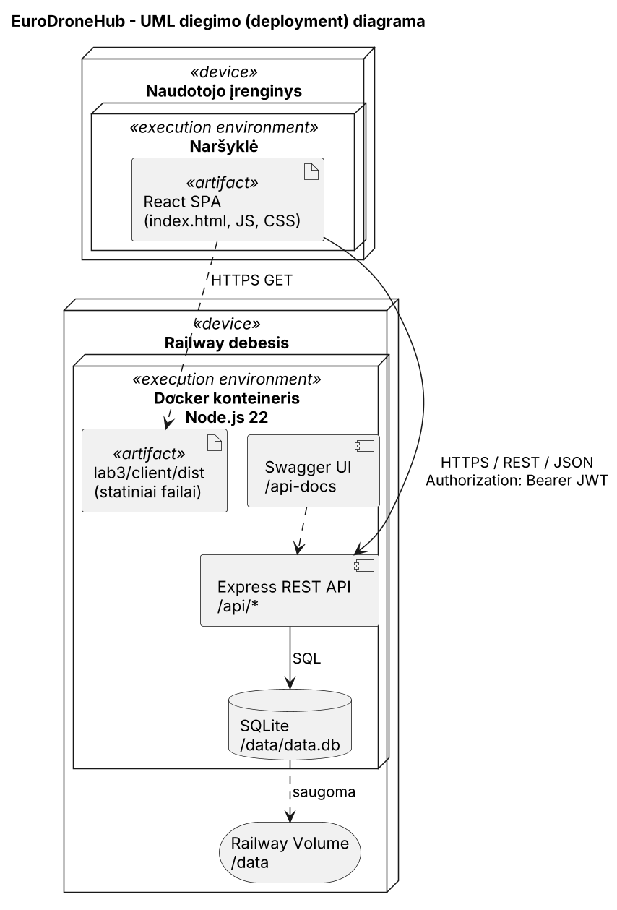

Visa sistema diegiama kaip vienas Docker konteineris Railway platformoje. Express serveris aptarnauja REST API (`/api/*`), Swagger dokumentaciją (`/api-docs`) ir sukompiliuotą React aplikaciją. Duomenys saugomi SQLite faile (Railway volume, kad išliktų tarp perdiegimų).

### 3.2 Duomenų modelis

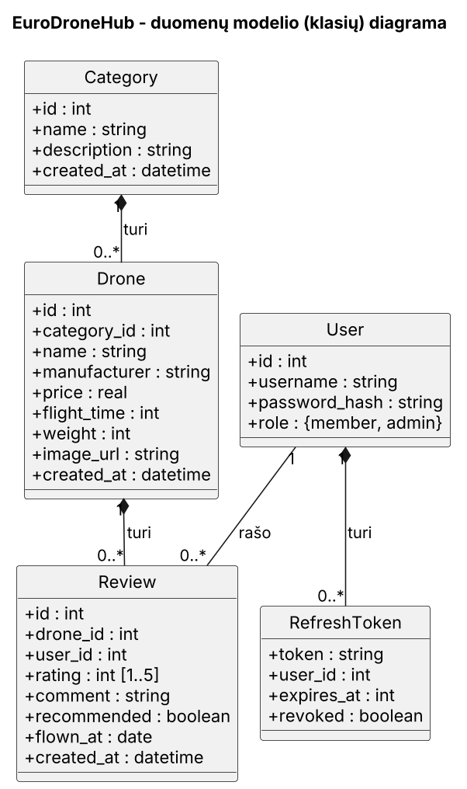

### 3.3 Projekto struktūra

```
saitynai/
├── lab0/                      0 LD: projekto užduotis
│   ├── Lab0_Projekto_uzduotis.docx
│   └── diagramos/             UML panaudos atvejų ir diegimo diagramos
├── lab1/                      1 LD: REST API
│   ├── Lab1_REST_API.docx
│   ├── api-spec.yaml          OpenAPI specifikacija (Swagger /api-docs)
│   ├── EuroDroneHub.postman_collection.json + 2 aplinkos
│   ├── diagramos/             UML klasių ir resursų diagramos
│   └── server/src/            Express API
│       ├── app.js             maršrutai, klaidų apdorojimas
│       ├── db.js              DB schema
│       ├── seed.js            pradiniai duomenys
│       ├── validate.js        užklausų validacija (400/422)
│       ├── list.js            puslapiavimas, filtrų skaitymas, hypermedia nuorodos
│       └── routes/            categories, drones, reviews, dashboard
├── lab2/                      2 LD: JWT autentifikacija
│   ├── Lab2_Autentifikacija_JWT.docx
│   ├── diagramos/             UML sekų ir veiklos diagramos
│   └── auth/
│       ├── auth.js            JWT kūrimas/tikrinimas, requireRole()
│       └── routes.js          register, login, refresh, logout, me
├── lab3/                      3 LD: naudotojo sąsaja
│   ├── client/                React (Vite) klientas
│   ├── wireframes/            langų wireframe'ai
│   └── screenshots/           realizacijos iškarpos
├── package.json               serverio priklausomybės ir komandos
├── Dockerfile, railway.json   diegimas debesyje
├── README.md                  greita prieiga (nuorodos, slaptažodžiai)
├── DEFENCE.md                 gynimo instrukcijos
└── ATASKAITA.md               pilna ataskaita
```

---

## 4. Paleidimas ir diegimas

### 4.1 Lokaliai

Reikia Node.js 22+.

```bash
npm run install:all   # įdiegia serverio ir kliento priklausomybes
npm run build         # sukompiliuoja React klientą
npm start             # http://localhost:3000
```

Kuriant galima paleisti atskirai: `npm run dev:api` (API, :3000) ir `npm run dev:client` (Vite, :5173, `/api` proxy į :3000).

Pirmą kartą paleidus DB automatiškai užpildoma pradiniais duomenimis. Iš naujo užpildyti: `npm run seed`.

Demonstracinės paskyros:

| Rolė | Vartotojas | Slaptažodis |
|---|---|---|
| Administratorius | `admin` | `admin123` |
| Narys | `jonas` | `jonas123` |
| Narys | `ruta` | `ruta123` |

Aplinkos kintamieji (žr. `.env.example`): `PORT`, `JWT_SECRET`, `ACCESS_TTL`, `DB_FILE`.

### 4.2 Debesyje (Railway)

Projektas turi `Dockerfile` ir `railway.json`, todėl Railway jį sukompiliuoja ir paleidžia automatiškai.

```bash
railway init -n eurodronehub                       # naujas projektas
railway up                                         # įkelia kodą ir sukuria servisą
railway variables --set "JWT_SECRET=<atsitiktinis_tekstas>" --set "DB_FILE=/data/data.db"
railway volume add --mount-path /data              # kad DB išliktų po perdiegimo
railway domain                                     # sugeneruoja viešą adresą
```

Alternatyva: Railway svetainėje *New Project → Deploy from GitHub repo* ir pasirinkti šią saugyklą.

---

## 5. Autentifikacija ir autorizacija

Naudojami **JWT** žetonai su **refresh token rotacijos** strategija:

- Prisijungus (`POST /api/auth/login`) grąžinami du žetonai:
  - **access token** – JWT (HS256), galioja 15 min., payload: `{ sub, username, role, jti }` (rolė ir ID saugomi žetono viduje, `jti` – unikalus žetono ID);
  - **refresh token** – atsitiktinė eilutė, saugoma DB, galioja 7 d.
- Access žetonas siunčiamas antraštėje `Authorization: Bearer <token>`.
- Pasibaigus access žetonui klientas kviečia `POST /api/auth/refresh` – senas refresh žetonas **atšaukiamas** ir išduodama nauja pora (rotacija).
- Jei bandoma panaudoti jau panaudotą refresh žetoną (galimas vagystės atvejis), atšaukiami **visi** to naudotojo refresh žetonai.
- Atsijungus (`POST /api/auth/logout`) refresh žetonas pažymimas atšauktu, o access žetono `jti` įrašomas į lentelę `revoked_tokens`. Todėl senu access žetonu naudotis nebegalima iš karto, nelaukiant, kol baigsis jo 15 min. galiojimas (atsakymas `401`).
- React klientas tai daro automatiškai: gavus `401` atnaujina žetoną ir pakartoja užklausą.

Iššifruoto access žetono pavyzdys:

```json
{ "sub": 1, "username": "admin", "role": "admin", "iat": 1794830594, "exp": 1794831494, "jti": "6f1c2b7e-4d1a-4c55-9a0e-2f3b8f1d9c11" }
```

Teisės:

| Veiksmas | Svečias | Narys | Moderatorius | Admin |
|---|:-:|:-:|:-:|:-:|
| GET (visi sąrašai, objektai, `/dashboard`) | ✔ | ✔ | ✔ | ✔ |
| `GET /auth/me` (profilis) | ✘ (401) | ✔ | ✔ | ✔ |
| Kategorijų / dronų POST, PUT, DELETE | ✘ (401) | ✘ (403) | ✘ (403) | ✔ |
| Atsiliepimo POST | ✘ (401) | ✔ | ✔ | ✔ |
| Atsiliepimo PUT, DELETE | ✘ (401) | tik savo (kitaip 403) | visi | visi |

Rolė tikrinama `requireRole()` ([`lab2/auth/auth.js`](lab2/auth/auth.js)), o atsiliepimo savininkas – `ownerOrModerator()` ([`lab1/server/src/routes/reviews.js`](lab1/server/src/routes/reviews.js)). Taip narys negali pakeisti kito naudotojo atsiliepimo, net jei žino jo ID.

---

## 6. API specifikacija

Pilna OpenAPI specifikacija: [`lab1/api-spec.yaml`](lab1/api-spec.yaml). Paleidus serverį ją galima peržiūrėti ir išbandyti adresu **`/api-docs`** (Swagger UI).

Bazinis adresas: `/api`. Visi atsakymai – `application/json`.

Visi sąrašai grąžinami puslapiais, o kiekvienas resursas turi `_links` (hypermedia) su susijusių resursų adresais:

```json
{
  "data": [ { "id": 1, "name": "FPV dronai", "...": "...", "_links": { "self": { "href": "/api/categories/1" }, "drones": { "href": "/api/categories/1/drones" } } } ],
  "meta": { "page": 1, "limit": 2, "total": 5, "totalPages": 3 },
  "_links": { "self": { "href": "/api/categories?page=1&limit=2" }, "first": { "...": "..." }, "last": { "...": "..." }, "next": { "href": "/api/categories?page=2&limit=2" } }
}
```

| Sąrašas | Puslapiavimas | Filtrai |
|---|---|---|
| `GET /categories` | `page`, `limit` (1–100, numatyta 10) | `search` (pavadinime ir aprašyme) |
| `GET /categories/{cid}/drones` | `page`, `limit` | `manufacturer`, `minPrice`, `maxPrice`, `search` |
| `GET /categories/{cid}/drones/{did}/reviews` | `page`, `limit` | `minRating`, `recommended` |

Neteisingos reikšmės (pvz. `page=0`, `minPrice=abc`) grąžina `400` su paaiškinimu.

### 6.1 Metodų sąrašas (15 + panelė + autentifikacija)

| # | Metodas | Kelias | Aprašymas | Atsako kodai |
|---|---|---|---|---|
| 1 | GET | `/categories` | Kategorijų sąrašas | 200, 400 |
| 2 | POST | `/categories` | Sukurti kategoriją | 201, 400, 401, 403, 422 |
| 3 | GET | `/categories/{id}` | Gauti kategoriją | 200, 404 |
| 4 | PUT | `/categories/{id}` | Atnaujinti kategoriją | 200, 400, 401, 403, 404, 422 |
| 5 | DELETE | `/categories/{id}` | Ištrinti kategoriją | 204, 401, 403, 404 |
| 6 | GET | `/categories/{cid}/drones` | **Hierarchinis**: kategorijos dronai | 200, 400, 404 |
| 7 | POST | `/categories/{cid}/drones` | Sukurti droną | 201, 400, 401, 403, 404, 422 |
| 8 | GET | `/categories/{cid}/drones/{id}` | Gauti droną | 200, 404 |
| 9 | PUT | `/categories/{cid}/drones/{id}` | Atnaujinti droną | 200, 400, 401, 403, 404, 422 |
| 10 | DELETE | `/categories/{cid}/drones/{id}` | Ištrinti droną | 204, 401, 403, 404 |
| 11 | GET | `/categories/{cid}/drones/{did}/reviews` | **Hierarchinis per visus 3 objektus**: drono atsiliepimai | 200, 400, 404 |
| 12 | POST | `/categories/{cid}/drones/{did}/reviews` | Parašyti atsiliepimą | 201, 400, 401, 404, 422 |
| 13 | GET | `/categories/{cid}/drones/{did}/reviews/{id}` | Gauti atsiliepimą | 200, 404 |
| 14 | PUT | `/categories/{cid}/drones/{did}/reviews/{id}` | Atnaujinti atsiliepimą | 200, 400, 401, 403, 404, 422 |
| 15 | DELETE | `/categories/{cid}/drones/{did}/reviews/{id}` | Ištrinti atsiliepimą | 204, 401, 403, 404 |
| – | POST | `/auth/register` | Registracija | 201, 400, 409, 422 |
| – | POST | `/auth/login` | Prisijungimas | 200, 400, 401, 422 |
| – | POST | `/auth/refresh` | Žetonų atnaujinimas | 200, 400, 401 |
| – | POST | `/auth/logout` | Atsijungimas (atšaukia abu žetonus) | 204 |
| – | GET | `/auth/me` | Profilis: naudotojas + jo atsiliepimai (4 esybės) | 200, 401 |
| – | GET | `/dashboard` | Panelė: statistika iš kategorijų, dronų, atsiliepimų ir naudotojų | 200 |

Klaidų kodų logika:
- **400** – neteisingas JSON, tuščias užklausos turinys arba neteisingi `?page`, `?limit`, filtrų parametrai;
- **401** – nėra žetono arba jis negalioja;
- **403** – rolė neturi teisės atlikti veiksmo;
- **404** – resursas (arba jo tėvinis resursas) nerastas;
- **409** – registruojamas jau esantis naudotojo vardas;
- **422** – JSON teisingas, bet laukų reikšmės netinkamos (pvz. `rating: 9` arba `PUT { "name": null }`).

Serveris niekada neturėtų grąžinti `500`: privalomų laukų `null` reikšmės sustabdomos validacijoje, o kliento klaidos (blogas JSON, blogai užkoduotas URL, per didelis turinys) paverčiamos `4xx` bendrame klaidų apdorojime ([`lab1/server/src/app.js`](lab1/server/src/app.js)).

### 6.2 Panaudojimo pavyzdžiai

**Prisijungimas**

```http
POST /api/auth/login
Content-Type: application/json

{ "username": "admin", "password": "admin123" }
```
```http
200 OK
{
  "accessToken": "eyJhbGciOiJIUzI1NiIsInR5cCI6IkpXVCJ9...",
  "refreshToken": "25c528caf495626860b2c063ea1bc38e...",
  "user": { "id": 1, "username": "admin", "role": "admin" }
}
```

**Žetonų atnaujinimas**

```http
POST /api/auth/refresh
Content-Type: application/json

{ "refreshToken": "25c528caf495626860b2c063ea1bc38e..." }
```
```http
200 OK
{ "accessToken": "eyJ...", "refreshToken": "9b1e...", "user": { "id": 1, "username": "admin", "role": "admin" } }
```

**1. Kategorijų sąrašas**

```http
GET /api/categories?page=2&limit=2
```
```http
200 OK
{
  "data": [
    { "id": 3, "name": "Pramoniniai dronai", "description": "Dronai inspekcijoms, kartografavimui ir žemės ūkiui.", "created_at": "2026-11-19 18:28:33", "drone_count": 2,
      "_links": { "self": { "href": "/api/categories/3" }, "drones": { "href": "/api/categories/3/drones" } } },
    { "id": 4, "name": "Mini dronai", "description": "Lengvesni nei 250 g dronai pradedantiesiems ...", "created_at": "2026-11-19 18:28:33", "drone_count": 2,
      "_links": { "self": { "href": "/api/categories/4" }, "drones": { "href": "/api/categories/4/drones" } } }
  ],
  "meta": { "page": 2, "limit": 2, "total": 5, "totalPages": 3 },
  "_links": {
    "self": { "href": "/api/categories?page=2&limit=2" }, "first": { "href": "/api/categories?page=1&limit=2" },
    "last": { "href": "/api/categories?page=3&limit=2" }, "prev": { "href": "/api/categories?page=1&limit=2" },
    "next": { "href": "/api/categories?page=3&limit=2" }
  }
}
```
```http
GET /api/categories?page=0
400 Bad Request
{ "error": "Neteisingi užklausos parametrai", "details": ["page turi būti sveikas skaičius >= 1"] }
```

**2. Sukurti kategoriją**

```http
POST /api/categories
Authorization: Bearer <admin token>
Content-Type: application/json

{ "name": "Mokomieji dronai", "description": "Pigūs dronai pradedantiesiems." }
```
```http
201 Created
Location: /api/categories/4
{ "id": 4, "name": "Mokomieji dronai", "description": "Pigūs dronai pradedantiesiems.", "created_at": "2026-11-16 12:10:00" }
```

**3. Gauti kategoriją**

```http
GET /api/categories/1
```
```http
200 OK
{ "id": 1, "name": "FPV dronai", "description": "Greiti, manevringi dronai ...", "created_at": "2026-11-16 12:03:13" }
```
```http
GET /api/categories/99999
404 Not Found
{ "error": "Kategorija nerasta" }
```

**4. Atnaujinti kategoriją**

```http
PUT /api/categories/4
Authorization: Bearer <admin token>
Content-Type: application/json

{ "name": "Mokomieji mini dronai" }
```
```http
200 OK
{ "id": 4, "name": "Mokomieji mini dronai", "description": "Pigūs dronai pradedantiesiems.", "created_at": "2026-11-16 12:10:00" }
```

**5. Ištrinti kategoriją**

```http
DELETE /api/categories/4
Authorization: Bearer <admin token>
```
```http
204 No Content
```

**6. Kategorijos dronai (hierarchinis)**

Filtras: DJI dronai, pigesni nei 1000 €.

```http
GET /api/categories/2/drones?manufacturer=DJI&maxPrice=1000
```
```http
200 OK
{
  "data": [
    { "id": 4, "category_id": 2, "name": "Mini 4 Pro", "manufacturer": "DJI", "price": 799, "flight_time": 34, "weight": 249, "image_url": "/img/cam-2.svg",
      "avg_rating": 4.5, "review_count": 2,
      "_links": { "self": { "href": "/api/categories/2/drones/4" }, "category": { "href": "/api/categories/2" }, "reviews": { "href": "/api/categories/2/drones/4/reviews" } } }
  ],
  "meta": { "page": 1, "limit": 10, "total": 1, "totalPages": 1 },
  "_links": { "self": { "href": "/api/categories/2/drones?manufacturer=DJI&maxPrice=1000&page=1&limit=10" }, "...": "..." }
}
```

**7. Sukurti droną**

```http
POST /api/categories/1/drones
Authorization: Bearer <admin token>
Content-Type: application/json

{ "name": "Tello", "manufacturer": "Ryze", "price": 99, "flight_time": 13, "weight": 80 }
```
```http
201 Created
{ "id": 8, "category_id": 1, "name": "Tello", "manufacturer": "Ryze", "price": 99, "flight_time": 13, "weight": 80, "image_url": null, "created_at": "..." }
```
Netinkami duomenys:
```http
POST /api/categories/1/drones
{ "name": "x" }

422 Unprocessable Entity
{ "error": "Validacijos klaida", "details": ["name per mažas (min 2)", "manufacturer yra privalomas", "price yra privalomas"] }
```

**8. Gauti droną**

```http
GET /api/categories/1/drones/1
```
```http
200 OK
{ "id": 1, "category_id": 1, "name": "Avata 2", "manufacturer": "DJI", "price": 999, "flight_time": 23, "weight": 377, "image_url": "/img/fpv-1.svg", "created_at": "2026-11-16 12:03:13" }
```

**9. Atnaujinti droną**

```http
PUT /api/categories/1/drones/8
Authorization: Bearer <admin token>
Content-Type: application/json

{ "price": 89.99 }
```
```http
200 OK
{ "id": 8, "category_id": 1, "name": "Tello", "manufacturer": "Ryze", "price": 89.99, ... }
```

**10. Ištrinti droną**

```http
DELETE /api/categories/1/drones/8
Authorization: Bearer <admin token>
```
```http
204 No Content
```

**11. Drono atsiliepimai**

```http
GET /api/categories/1/drones/1/reviews?minRating=5
```
```http
200 OK
{
  "data": [
    { "id": 1, "drone_id": 1, "user_id": 2, "rating": 5, "comment": "Labai lengva valdyti, puikus vaizdas akiniuose.", "recommended": true, "flown_at": "2025-06-12", "username": "jonas",
      "_links": { "self": { "href": "/api/categories/1/drones/1/reviews/1" }, "drone": { "href": "/api/categories/1/drones/1" } } }
  ],
  "meta": { "page": 1, "limit": 10, "total": 1, "totalPages": 1 },
  "_links": { "self": { "href": "/api/categories/1/drones/1/reviews?minRating=5&page=1&limit=10" }, "...": "..." }
}
```

**12. Parašyti atsiliepimą**

```http
POST /api/categories/1/drones/1/reviews
Authorization: Bearer <nario token>
Content-Type: application/json

{ "rating": 4, "comment": "Puikus dronas mokytis.", "recommended": true, "flown_at": "2025-10-01" }
```
```http
201 Created
{ "id": 8, "drone_id": 1, "user_id": 2, "rating": 4, "comment": "Puikus dronas mokytis.", "recommended": true, "flown_at": "2025-10-01", "username": "jonas", "created_at": "..." }
```
Blogas JSON:
```http
POST /api/categories/1/drones/1/reviews
{ "rating": 4,

400 Bad Request
{ "error": "Neteisingas JSON formatas" }
```

**13. Gauti atsiliepimą**

```http
GET /api/categories/1/drones/1/reviews/1
```
```http
200 OK
{ "id": 1, "drone_id": 1, "user_id": 2, "rating": 5, "comment": "Labai lengva valdyti, puikus vaizdas akiniuose.", "recommended": true, "flown_at": "2025-06-12", "username": "jonas" }
```

**14. Atnaujinti atsiliepimą**

```http
PUT /api/categories/1/drones/1/reviews/8
Authorization: Bearer <nario token>
Content-Type: application/json

{ "rating": 5 }
```
```http
200 OK
{ "id": 8, "rating": 5, "comment": "Puikus dronas mokytis.", ... }
```
Kito naudotojo atsiliepimas:
```http
403 Forbidden
{ "error": "Galite keisti tik savo atsiliepimus" }
```

**15. Ištrinti atsiliepimą**

```http
DELETE /api/categories/1/drones/1/reviews/8
Authorization: Bearer <nario token>
```
```http
204 No Content
```

**Panelė (dashboard)** – vienas resursas iš 4 lentelių:

```http
GET /api/dashboard
```
```http
200 OK
{
  "totals": { "categories": 5, "drones": 11, "reviews": 11, "users": 5, "avg_rating": 4.27 },
  "categories": [ { "id": 1, "name": "FPV dronai", "drone_count": 2, "avg_price": 664, "min_price": 329, "max_price": 999, "_links": { "...": "..." } } ],
  "topDrones": [ { "id": 3, "name": "Mavic 3 Pro", "manufacturer": "DJI", "category_name": "Filmavimo dronai", "avg_rating": 5, "review_count": 1, "_links": { "...": "..." } } ],
  "latestReviews": [ { "id": 11, "rating": 4, "username": "tomas", "drone_name": "Mini 4 Pro", "category_name": "Filmavimo dronai", "_links": { "...": "..." } } ],
  "_links": { "self": { "href": "/api/dashboard" }, "categories": { "href": "/api/categories" } }
}
```

**Profilis**

```http
GET /api/auth/me
Authorization: Bearer <nario token>
```
```http
200 OK
{
  "id": 2, "username": "jonas", "role": "member",
  "stats": { "review_count": 4, "avg_rating": 4.8 },
  "reviews": [ { "id": 7, "rating": 5, "comment": "Naudojame elektros linijų inspekcijoms ...", "drone_name": "Matrice 350 RTK", "category_name": "Pramoniniai dronai", "_links": { "...": "..." } } ],
  "_links": { "self": { "href": "/api/auth/me" }, "logout": { "href": "/api/auth/logout", "method": "POST" } }
}
```

**Atsijungimas**

```http
POST /api/auth/logout
Authorization: Bearer <access token>
Content-Type: application/json

{ "refreshToken": "25c528caf495626860b2c063ea1bc38e..." }
```
```http
204 No Content
```
Tas pats access žetonas po atsijungimo:
```http
GET /api/auth/me
401 Unauthorized
{ "error": "Žetonas atšauktas (naudotojas atsijungė)" }
```

---

## 7. Naudotojo sąsajos projektas

Sąsajoje naudojamas vientisas tamsiai mėlynos (#0f172a) ir oranžinės (#f97316) spalvų derinys, *Exo 2* ir *Inter* šriftai (Google Fonts), SVG ikonos. Išdėstymas paremtas CSS grid tinkleliu (3 → 2 → 1 stulpelis), breakpoint'as ties **768px**: mobiliame vaizde meniu tampa „hamburger“ meniu. Antraštė, turinys ir poraštė turi skirtingą stilių (pvz. nuorodos antraštėje – su animuotu pabraukimu, turinyje – oranžinės, poraštėje – pilkos, užvedus pasislenka). Naudojamos animacijos (kortelių pakilimas, modalinio lango atsiradimas, logotipo pasisukimas, meniu išsiskleidimas). Modaliniame lange rodoma drono specifikacija, kategorijų/dronų/atsiliepimų kūrimo ir redagavimo formos bei ištrynimo patvirtinimas (naršyklės `alert()`/`confirm()` nenaudojami). Apie kiekvieną veiksmą naudotojas informuojamas iššokančiu pranešimu (toast) apatiniame dešiniajame kampe, o kraunant duomenis rodomas animuotas indikatorius. Visi meniu punktai turi SVG ikonėles. Sąrašuose yra paieška, filtrai (gamintojas, kaina, įvertinimas) ir puslapiavimas, naudojantys API `?page`, `?limit` ir filtrų parametrus. Atskiri puslapiai: **Statistika** (`/dashboard`) ir **Profilis** (`/profile`, naudotojo atsiliepimai). Formose naudojami skirtingi įvesties elementai: `text`, `password`, `number`, `select`, `range`, `date`, `checkbox`, `textarea`.

| Wireframe | Realizacija |
|---|---|
| 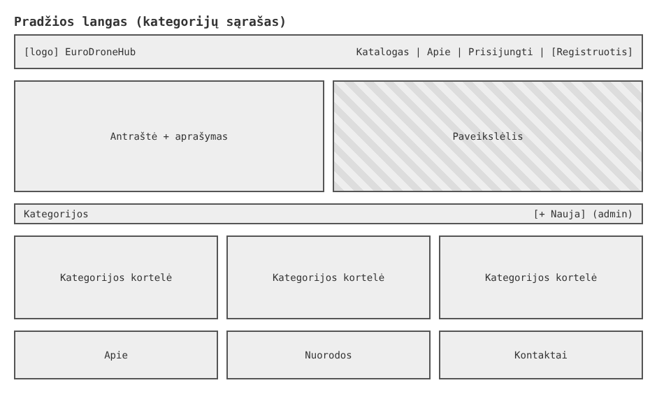 | 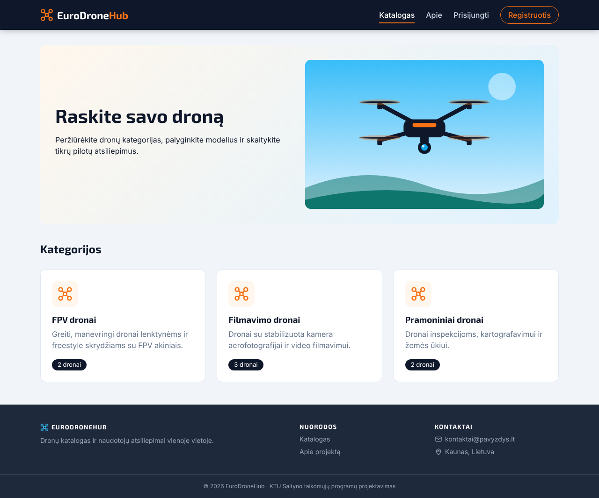 |
| 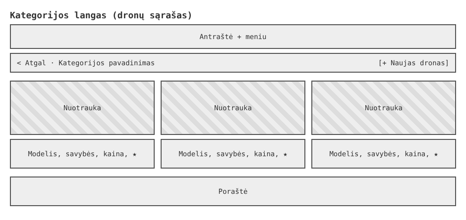 | 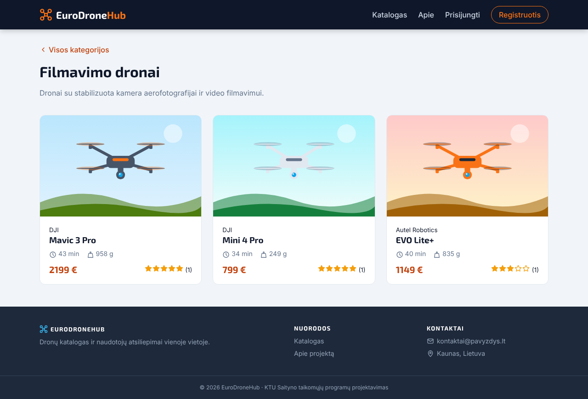 |
| 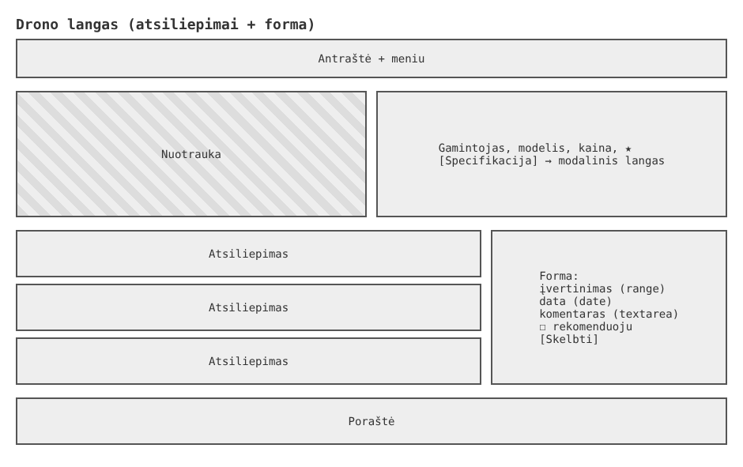 | 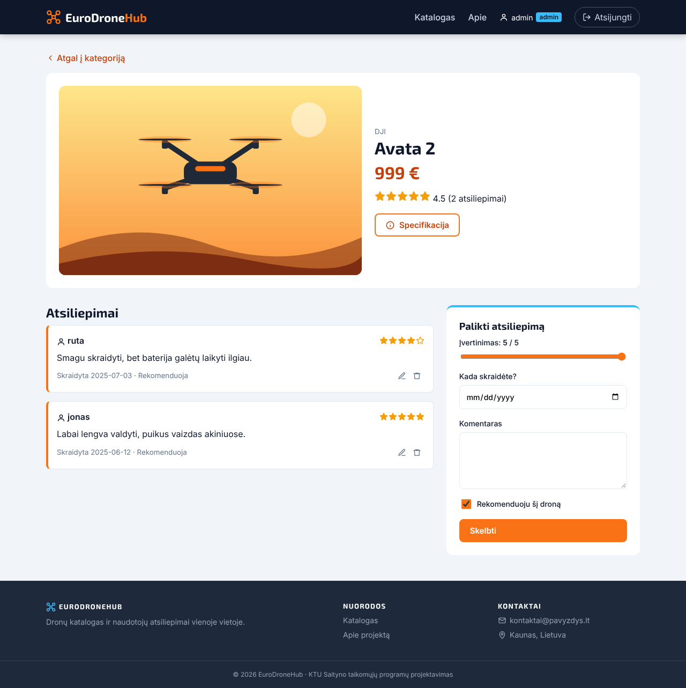 |
| 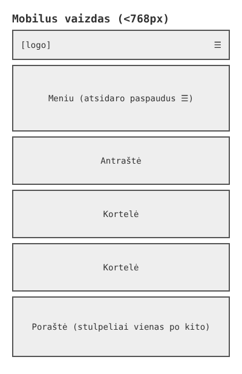 | 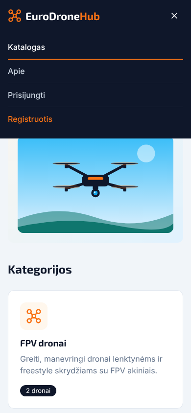 |

Kitos iškarpos:

| Modalinis langas (specifikacija) | Drono forma (admin) | Prisijungimas |
|---|---|---|
| 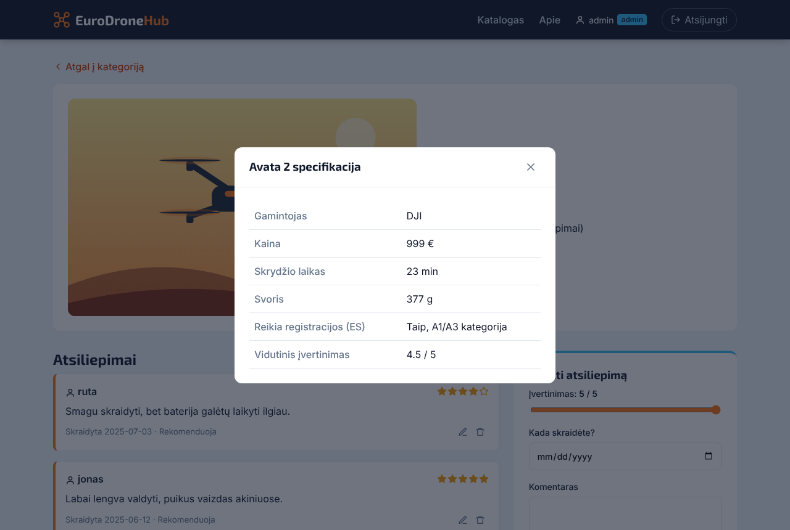 | 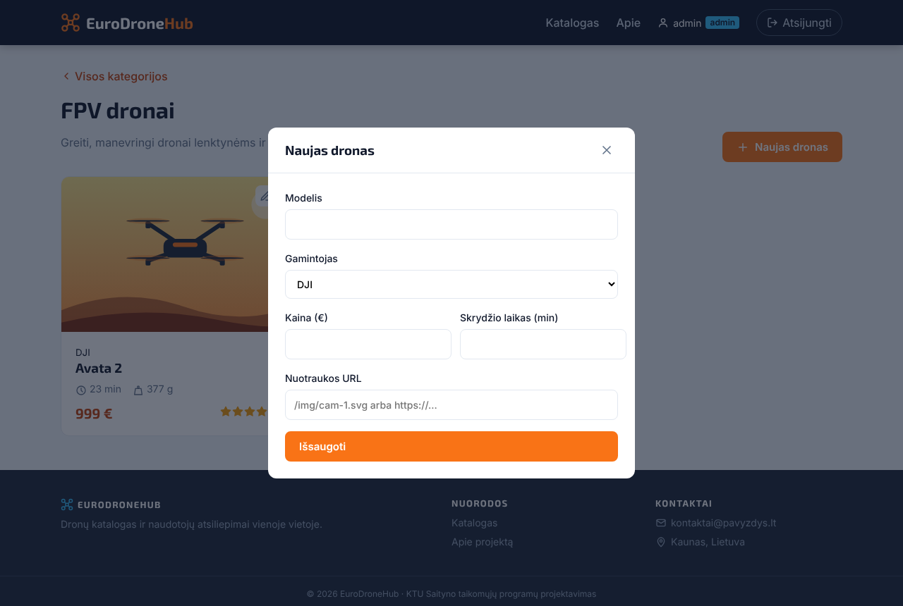 | 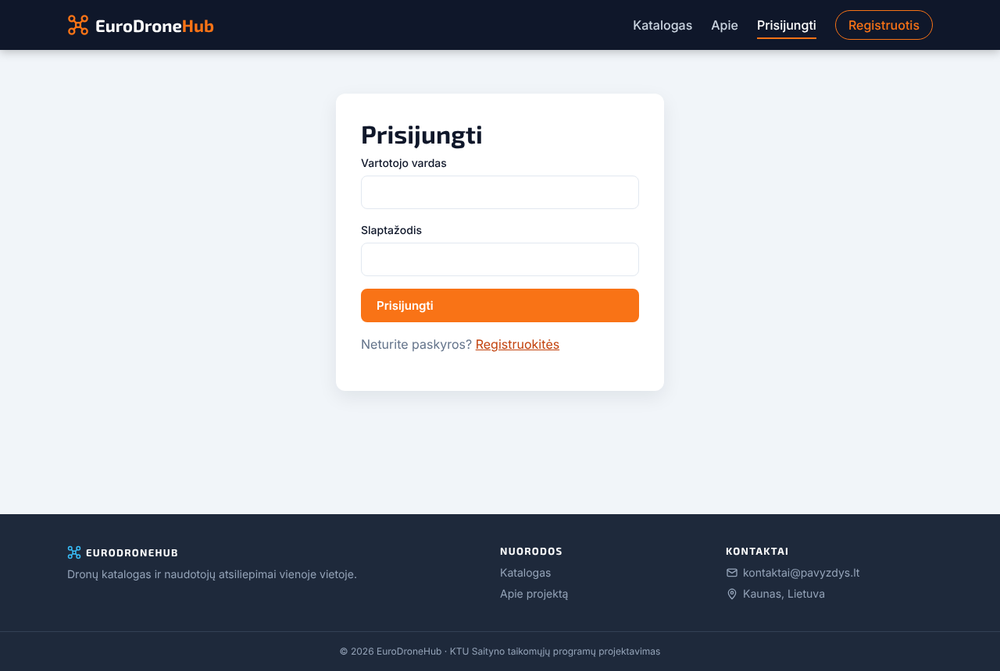 |

---

## 8. Testavimas

Postman kolekcija [`lab1/EuroDroneHub.postman_collection.json`](lab1/EuroDroneHub.postman_collection.json) patikrina visus prieigos taškus: 15 CRUD metodų, panelę, registraciją, prisijungimą, žetonų atnaujinimą, profilį ir atsijungimą. Taip pat tikrinamas puslapiavimas ir filtrai, hypermedia nuorodos, klaidų atvejai (400, 401, 403, 404, 409, 422), sukūrimas (201), ištrynimas (204), rolių apribojimai (narys negali keisti svetimo atsiliepimo, moderatorius gali, bet negali kurti kategorijų) ir tai, kad po atsijungimo abu žetonai nebegalioja. Kolekcija pati užregistruoja naują naudotoją, prisijungia, išsisaugo žetonus ir sukurtų objektų ID.

Paleidimas (serveris turi veikti):

```bash
npm run test:api
# arba kitam adresui:
npx newman run lab1/EuroDroneHub.postman_collection.json --env-var baseUrl=https://<railway-adresas>
```

Rezultatas: 48 užklausos, 116 patikrinimų, 0 klaidų, ~5 s.

Postman programoje: *Import* → pasirinkti failą → *Run collection*.

---

## 9. Išvados

1. Suprojektuota ir realizuota REST principais veikianti API su trimis hierarchiškai susietais objektais (kategorija → dronas → atsiliepimas) ir 15 CRUD metodų. Kadangi kiekvienas vaikinis resursas pasiekiamas tik per tėvinį URL, API pats patikrina, ar dronas tikrai priklauso nurodytai kategorijai, todėl negalima pasiekti svetimo resurso pakeitus vieną ID.
2. Sąrašai grąžinami puslapiais su filtrais ir hypermedia nuorodomis. Klientas naršo pagal `_links.next` ir nekuria adresų pats, o serveris niekada negrąžina visos lentelės iš karto. Panelė (`/dashboard`) ir profilis (`/auth/me`) parodė, kad vienas užklausimas, sujungiantis 4 lenteles, klientui patogesnis nei keli atskiri.
3. Įgyvendinta JWT autentifikacija su refresh žetonų rotacija ir pakartotinio panaudojimo aptikimu. Rolė ir ID saugomi žetono viduje, todėl teisėms patikrinti nereikia kreiptis į DB. Pats JWT yra be būsenos, todėl jo „atšaukimui“ atsijungus vis tiek prireikė nedidelės `revoked_tokens` lentelės – tai kompromisas tarp stateless principo ir saugumo.
4. Realizuotos 3 prisijungusių naudotojų rolės (narys, moderatorius, administratorius) ir savininko patikra. Vien rolės nepakanka: be `ownerOrModerator()` patikros bet kuris narys galėtų redaguoti svetimus atsiliepimus.
5. API grąžina prasmingus atsako kodus (200, 201, 204, 400, 401, 403, 404, 409, 422) ir niekada 500. Testuojant paaiškėjo, kad `PUT { "name": null }` sukeldavo DB klaidą (500), todėl validacija papildyta privalomų laukų išvalymo draudimu. Elgsena aprašyta OpenAPI specifikacija ir patikrinta 116 automatinių Postman patikrinimų.
6. Sukurta prisitaikanti React naudotojo sąsaja su hamburger meniu, modaliniais langais, animacijomis, pranešimais ir įvairiais formų elementais.
7. Sistema supakuota į vieną Docker konteinerį ir išdiegta Railway debesų platformoje. SQLite pasirinkimas supaprastino paleidimą ir diegimą, tačiau didesnei apkrovai tikslinga būtų pereiti prie PostgreSQL.
