# EuroDroneHub – dronų katalogas ir atsiliepimų sistema

Modulio „Saityno taikomųjų programų projektavimas“ projektas.

## Turinys

1. [Sprendžiamo uždavinio aprašymas](#1-sprendžiamo-uždavinio-aprašymas)
2. [Pasirinktos technologijos](#2-pasirinktos-technologijos)
3. [Sistemos architektūra](#3-sistemos-architektūra)
4. [Paleidimas ir diegimas](#4-paleidimas-ir-diegimas)
5. [Autentifikacija ir autorizacija](#5-autentifikacija-ir-autorizacija)
6. [API specifikacija](#6-api-specifikacija)
7. [Naudotojo sąsajos projektas](#7-naudotojo-sąsajos-projektas)
8. [Testavimas](#8-testavimas)
9. [Išvados](#9-išvados)

---

## 1. Sprendžiamo uždavinio aprašymas

### 1.1 Sistemos paskirtis

EuroDroneHub – internetinė platforma dronų entuziastams ir pirkėjams. Sistemoje dronai suskirstyti į kategorijas (FPV, filmavimo, pramoniniai ir kt.), kiekvienas dronas turi savo techninius duomenis, o registruoti naudotojai gali dalintis patirtimi rašydami atsiliepimus. Tokiu būdu pirkėjas vienoje vietoje gali palyginti modelius ir pamatyti realių pilotų vertinimus.

Taikomosios srities objektų hierarchija:

```
Kategorija (Category) -> Dronas (Drone) -> Atsiliepimas (Review)
```

### 1.2 Funkciniai reikalavimai

**Svečias** (neprisijungęs naudotojas):
- peržiūrėti dronų kategorijų sąrašą;
- peržiūrėti konkrečios kategorijos dronus;
- peržiūrėti drono informaciją, specifikaciją ir atsiliepimus;
- užsiregistruoti ir prisijungti.

**Narys** (prisijungęs naudotojas):
- viskas, ką gali svečias;
- parašyti atsiliepimą apie droną (įvertinimas 1–5, komentaras, skrydžio data, rekomendacija);
- redaguoti ir ištrinti savo atsiliepimus;
- atsijungti.

**Administratorius**:
- viskas, ką gali narys;
- kurti, redaguoti ir trinti kategorijas;
- kurti, redaguoti ir trinti dronus;
- redaguoti ir trinti bet kurio naudotojo atsiliepimus.

---

## 2. Pasirinktos technologijos

| Sritis | Technologija | Kodėl |
|---|---|---|
| Serveris | **Node.js 22 + Express 5** | Paprastas, greitai sukuriamas REST API, didelė bendruomenė |
| Duomenų bazė | **SQLite** (`node:sqlite`) | Integruota į Node.js, nereikia atskiro DB serverio, lengva paleisti ir diegti |
| Autentifikacija | **JWT** (`jsonwebtoken`) + refresh žetonai DB | Be būsenos (stateless) access žetonas, rolė žetono viduje |
| Slaptažodžiai | `bcryptjs` | Saugus slaptažodžių maišymas |
| Klientas | **React 19 + Vite** | Komponentinis UI, greitas kūrimas ir build |
| Maršrutizavimas | `react-router-dom` | SPA puslapių navigacija |
| Stilius | Gryna CSS, Google Fonts (*Exo 2*, *Inter*), SVG ikonos | Nereikia papildomų bibliotekų |
| API dokumentacija | **OpenAPI 3** + Swagger UI | [`docs/api-spec.yaml`](docs/api-spec.yaml), interaktyviai `/api-docs` |
| Testavimas | **Postman / Newman** | [`docs/EuroDroneHub.postman_collection.json`](docs/EuroDroneHub.postman_collection.json) |
| Diegimas | **Docker** + **Railway** (debesų platforma) | Vienas konteineris aptarnauja ir API, ir klientą |

---

## 3. Sistemos architektūra

### 3.1 Diegimo (deployment) diagrama

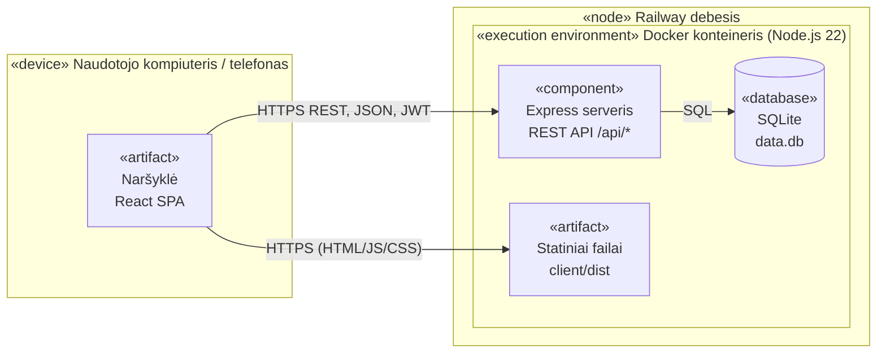

Visa sistema diegiama kaip vienas Docker konteineris Railway platformoje. Express serveris aptarnauja REST API (`/api/*`), Swagger dokumentaciją (`/api-docs`) ir sukompiliuotą React aplikaciją. Duomenys saugomi SQLite faile (Railway volume, kad išliktų tarp perdiegimų).

### 3.2 Duomenų modelis

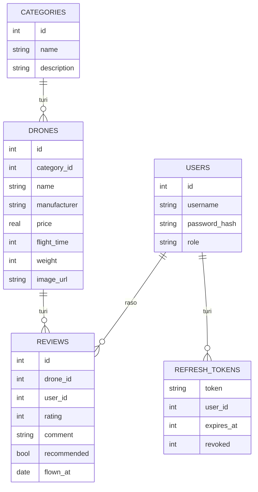

### 3.3 Projekto struktūra

```
├── server/            Express REST API
│   └── src/
│       ├── app.js       maršrutai, klaidų apdorojimas
│       ├── auth.js      JWT, rolių tikrinimas
│       ├── db.js        DB schema
│       ├── seed.js      pradiniai duomenys
│       ├── validate.js  užklausų validacija (400/422)
│       └── routes/      auth, categories, drones, reviews
├── client/            React (Vite) klientas
├── docs/
│   ├── api-spec.yaml                       OpenAPI specifikacija
│   ├── EuroDroneHub.postman_collection.json Postman testai
│   ├── wireframes/                         langų wireframe'ai
│   └── screenshots/                        realizacijos iškarpos
├── Dockerfile
└── railway.json
```

---

## 4. Paleidimas ir diegimas

### 4.1 Lokaliai

Reikia Node.js 22+.

```bash
npm run install:all   # įdiegia server ir client priklausomybes
npm run build         # sukompiliuoja React klientą
npm start             # http://localhost:3000
```

Kuriant galima paleisti atskirai: `npm run dev:api` (API, :3000) ir `npm run dev:client` (Vite, :5173, `/api` proxy į :3000).

Pirmą kartą paleidus DB automatiškai užpildoma pradiniais duomenimis. Iš naujo užpildyti: `npm run seed`.

Demonstracinės paskyros:

| Rolė | Vartotojas | Slaptažodis |
|---|---|---|
| Administratorius | `admin` | `admin123` |
| Narys | `jonas` | `jonas123` |
| Narys | `ruta` | `ruta123` |

Aplinkos kintamieji (žr. `.env.example`): `PORT`, `JWT_SECRET`, `ACCESS_TTL`, `DB_FILE`.

### 4.2 Debesyje (Railway)

Projektas turi `Dockerfile` ir `railway.json`, todėl Railway jį sukompiliuoja ir paleidžia automatiškai.

```bash
railway init -n eurodronehub                       # naujas projektas
railway up                                         # įkelia kodą ir sukuria servisą
railway variables --set "JWT_SECRET=<atsitiktinis_tekstas>" --set "DB_FILE=/data/data.db"
railway volume add --mount-path /data              # kad DB išliktų po perdiegimo
railway domain                                     # sugeneruoja viešą adresą
```

Alternatyva: Railway svetainėje *New Project → Deploy from GitHub repo* ir pasirinkti šią saugyklą.

---

## 5. Autentifikacija ir autorizacija

Naudojami **JWT** žetonai su **refresh token rotacijos** strategija:

- Prisijungus (`POST /api/auth/login`) grąžinami du žetonai:
  - **access token** – JWT, galioja 15 min., payload: `{ sub, username, role }` (rolė saugoma žetono viduje);
  - **refresh token** – atsitiktinė eilutė, saugoma DB, galioja 7 d.
- Access žetonas siunčiamas antraštėje `Authorization: Bearer <token>`.
- Pasibaigus access žetonui klientas kviečia `POST /api/auth/refresh` – senas refresh žetonas **atšaukiamas** ir išduodama nauja pora (rotacija).
- Jei bandoma panaudoti jau panaudotą refresh žetoną (galimas vagystės atvejis), atšaukiami **visi** to naudotojo refresh žetonai.
- Atsijungus (`POST /api/auth/logout`) refresh žetonas atšaukiamas.
- React klientas tai daro automatiškai: gavus `401` atnaujina žetoną ir pakartoja užklausą.

Iššifruoto access žetono pavyzdys:

```json
{ "sub": 1, "username": "admin", "role": "admin", "iat": 1794830594, "exp": 1794831494 }
```

Teisės:

| Veiksmas | Svečias | Narys | Admin |
|---|:-:|:-:|:-:|
| GET (visi sąrašai ir objektai) | ✔ | ✔ | ✔ |
| Kategorijų / dronų POST, PUT, DELETE | ✘ (401) | ✘ (403) | ✔ |
| Atsiliepimo POST | ✘ (401) | ✔ | ✔ |
| Atsiliepimo PUT, DELETE | ✘ (401) | tik savo (kitaip 403) | ✔ |

---

## 6. API specifikacija

Pilna OpenAPI specifikacija: [`docs/api-spec.yaml`](docs/api-spec.yaml). Paleidus serverį ją galima peržiūrėti ir išbandyti adresu **`/api-docs`** (Swagger UI).

Bazinis adresas: `/api`. Visi atsakymai – `application/json`.

### 6.1 Metodų sąrašas (15 + autentifikacija)

| # | Metodas | Kelias | Aprašymas | Atsako kodai |
|---|---|---|---|---|
| 1 | GET | `/categories` | Kategorijų sąrašas | 200 |
| 2 | POST | `/categories` | Sukurti kategoriją | 201, 400, 401, 403, 422 |
| 3 | GET | `/categories/{id}` | Gauti kategoriją | 200, 404 |
| 4 | PUT | `/categories/{id}` | Atnaujinti kategoriją | 200, 400, 401, 403, 404, 422 |
| 5 | DELETE | `/categories/{id}` | Ištrinti kategoriją | 204, 401, 403, 404 |
| 6 | GET | `/categories/{cid}/drones` | **Hierarchinis**: visi kategorijos dronai | 200, 404 |
| 7 | POST | `/categories/{cid}/drones` | Sukurti droną | 201, 400, 401, 403, 404, 422 |
| 8 | GET | `/categories/{cid}/drones/{id}` | Gauti droną | 200, 404 |
| 9 | PUT | `/categories/{cid}/drones/{id}` | Atnaujinti droną | 200, 400, 401, 403, 404, 422 |
| 10 | DELETE | `/categories/{cid}/drones/{id}` | Ištrinti droną | 204, 401, 403, 404 |
| 11 | GET | `/categories/{cid}/drones/{did}/reviews` | Drono atsiliepimai | 200, 404 |
| 12 | POST | `/categories/{cid}/drones/{did}/reviews` | Parašyti atsiliepimą | 201, 400, 401, 404, 422 |
| 13 | GET | `/categories/{cid}/drones/{did}/reviews/{id}` | Gauti atsiliepimą | 200, 404 |
| 14 | PUT | `/categories/{cid}/drones/{did}/reviews/{id}` | Atnaujinti atsiliepimą | 200, 400, 401, 403, 404, 422 |
| 15 | DELETE | `/categories/{cid}/drones/{did}/reviews/{id}` | Ištrinti atsiliepimą | 204, 401, 403, 404 |
| – | POST | `/auth/register` | Registracija | 201, 400, 409, 422 |
| – | POST | `/auth/login` | Prisijungimas | 200, 400, 401, 422 |
| – | POST | `/auth/refresh` | Žetonų atnaujinimas | 200, 400, 401 |
| – | POST | `/auth/logout` | Atsijungimas | 204 |

Klaidų kodų logika:
- **400** – neteisingas JSON arba tuščias užklausos turinys;
- **401** – nėra žetono arba jis negalioja;
- **403** – rolė neturi teisės atlikti veiksmo;
- **404** – resursas (arba jo tėvinis resursas) nerastas;
- **422** – JSON teisingas, bet laukų reikšmės netinkamos (pvz. `rating: 9`).

### 6.2 Panaudojimo pavyzdžiai

**Prisijungimas**

```http
POST /api/auth/login
Content-Type: application/json

{ "username": "admin", "password": "admin123" }
```
```http
200 OK
{
  "accessToken": "eyJhbGciOiJIUzI1NiIsInR5cCI6IkpXVCJ9...",
  "refreshToken": "25c528caf495626860b2c063ea1bc38e...",
  "user": { "id": 1, "username": "admin", "role": "admin" }
}
```

**Žetonų atnaujinimas**

```http
POST /api/auth/refresh
Content-Type: application/json

{ "refreshToken": "25c528caf495626860b2c063ea1bc38e..." }
```
```http
200 OK
{ "accessToken": "eyJ...", "refreshToken": "9b1e...", "user": { "id": 1, "username": "admin", "role": "admin" } }
```

**1. Kategorijų sąrašas**

```http
GET /api/categories
```
```http
200 OK
[
  { "id": 1, "name": "FPV dronai", "description": "Greiti, manevringi dronai lenktynėms ir freestyle skrydžiams su FPV akiniais.", "created_at": "2026-11-16 12:03:13", "drone_count": 2 },
  { "id": 2, "name": "Filmavimo dronai", "description": "Dronai su stabilizuota kamera aerofotografijai ir video filmavimui.", "created_at": "2026-11-16 12:03:13", "drone_count": 3 }
]
```

**2. Sukurti kategoriją**

```http
POST /api/categories
Authorization: Bearer <admin token>
Content-Type: application/json

{ "name": "Mokomieji dronai", "description": "Pigūs dronai pradedantiesiems." }
```
```http
201 Created
Location: /api/categories/4
{ "id": 4, "name": "Mokomieji dronai", "description": "Pigūs dronai pradedantiesiems.", "created_at": "2026-11-16 12:10:00" }
```

**3. Gauti kategoriją**

```http
GET /api/categories/1
```
```http
200 OK
{ "id": 1, "name": "FPV dronai", "description": "Greiti, manevringi dronai ...", "created_at": "2026-11-16 12:03:13" }
```
```http
GET /api/categories/99999
404 Not Found
{ "error": "Kategorija nerasta" }
```

**4. Atnaujinti kategoriją**

```http
PUT /api/categories/4
Authorization: Bearer <admin token>
Content-Type: application/json

{ "name": "Mokomieji mini dronai" }
```
```http
200 OK
{ "id": 4, "name": "Mokomieji mini dronai", "description": "Pigūs dronai pradedantiesiems.", "created_at": "2026-11-16 12:10:00" }
```

**5. Ištrinti kategoriją**

```http
DELETE /api/categories/4
Authorization: Bearer <admin token>
```
```http
204 No Content
```

**6. Kategorijos dronai (hierarchinis)**

```http
GET /api/categories/1/drones
```
```http
200 OK
[
  { "id": 1, "category_id": 1, "name": "Avata 2", "manufacturer": "DJI", "price": 999, "flight_time": 23, "weight": 377, "image_url": "/img/fpv-1.svg", "avg_rating": 4.5, "review_count": 2 },
  { "id": 2, "category_id": 1, "name": "Nazgul5 V3", "manufacturer": "iFlight", "price": 329, "flight_time": 8, "weight": 640, "image_url": "/img/fpv-2.svg", "avg_rating": 4, "review_count": 1 }
]
```

**7. Sukurti droną**

```http
POST /api/categories/1/drones
Authorization: Bearer <admin token>
Content-Type: application/json

{ "name": "Tello", "manufacturer": "Ryze", "price": 99, "flight_time": 13, "weight": 80 }
```
```http
201 Created
{ "id": 8, "category_id": 1, "name": "Tello", "manufacturer": "Ryze", "price": 99, "flight_time": 13, "weight": 80, "image_url": null, "created_at": "..." }
```
Netinkami duomenys:
```http
POST /api/categories/1/drones
{ "name": "x" }

422 Unprocessable Entity
{ "error": "Validacijos klaida", "details": ["name per mažas (min 2)", "manufacturer yra privalomas", "price yra privalomas"] }
```

**8. Gauti droną**

```http
GET /api/categories/1/drones/1
```
```http
200 OK
{ "id": 1, "category_id": 1, "name": "Avata 2", "manufacturer": "DJI", "price": 999, "flight_time": 23, "weight": 377, "image_url": "/img/fpv-1.svg", "created_at": "2026-11-16 12:03:13" }
```

**9. Atnaujinti droną**

```http
PUT /api/categories/1/drones/8
Authorization: Bearer <admin token>
Content-Type: application/json

{ "price": 89.99 }
```
```http
200 OK
{ "id": 8, "category_id": 1, "name": "Tello", "manufacturer": "Ryze", "price": 89.99, ... }
```

**10. Ištrinti droną**

```http
DELETE /api/categories/1/drones/8
Authorization: Bearer <admin token>
```
```http
204 No Content
```

**11. Drono atsiliepimai**

```http
GET /api/categories/1/drones/1/reviews
```
```http
200 OK
[
  { "id": 2, "drone_id": 1, "user_id": 3, "rating": 4, "comment": "Smagu skraidyti, bet baterija galėtų laikyti ilgiau.", "recommended": true, "flown_at": "2025-07-03", "username": "ruta" },
  { "id": 1, "drone_id": 1, "user_id": 2, "rating": 5, "comment": "Labai lengva valdyti, puikus vaizdas akiniuose.", "recommended": true, "flown_at": "2025-06-12", "username": "jonas" }
]
```

**12. Parašyti atsiliepimą**

```http
POST /api/categories/1/drones/1/reviews
Authorization: Bearer <nario token>
Content-Type: application/json

{ "rating": 4, "comment": "Puikus dronas mokytis.", "recommended": true, "flown_at": "2025-10-01" }
```
```http
201 Created
{ "id": 8, "drone_id": 1, "user_id": 2, "rating": 4, "comment": "Puikus dronas mokytis.", "recommended": true, "flown_at": "2025-10-01", "username": "jonas", "created_at": "..." }
```
Blogas JSON:
```http
POST /api/categories/1/drones/1/reviews
{ "rating": 4,

400 Bad Request
{ "error": "Neteisingas JSON formatas" }
```

**13. Gauti atsiliepimą**

```http
GET /api/categories/1/drones/1/reviews/1
```
```http
200 OK
{ "id": 1, "drone_id": 1, "user_id": 2, "rating": 5, "comment": "Labai lengva valdyti, puikus vaizdas akiniuose.", "recommended": true, "flown_at": "2025-06-12", "username": "jonas" }
```

**14. Atnaujinti atsiliepimą**

```http
PUT /api/categories/1/drones/1/reviews/8
Authorization: Bearer <nario token>
Content-Type: application/json

{ "rating": 5 }
```
```http
200 OK
{ "id": 8, "rating": 5, "comment": "Puikus dronas mokytis.", ... }
```
Kito naudotojo atsiliepimas:
```http
403 Forbidden
{ "error": "Galite keisti tik savo atsiliepimus" }
```

**15. Ištrinti atsiliepimą**

```http
DELETE /api/categories/1/drones/1/reviews/8
Authorization: Bearer <nario token>
```
```http
204 No Content
```

---

## 7. Naudotojo sąsajos projektas

Sąsajoje naudojamas vientisas tamsiai mėlynos (#0f172a) ir oranžinės (#f97316) spalvų derinys, *Exo 2* ir *Inter* šriftai (Google Fonts), SVG ikonos. Išdėstymas paremtas CSS grid tinkleliu (3 → 2 → 1 stulpelis), breakpoint'as ties **768px**: mobiliame vaizde meniu tampa „hamburger“ meniu. Antraštė, turinys ir poraštė turi skirtingą stilių (pvz. nuorodos antraštėje – su animuotu pabraukimu, turinyje – oranžinės, poraštėje – pilkos, užvedus pasislenka). Naudojamos animacijos (kortelių pakilimas, modalinio lango atsiradimas, logotipo pasisukimas, meniu išsiskleidimas). Modaliniame lange rodoma drono specifikacija ir kategorijų/dronų/atsiliepimų redagavimo formos. Formose naudojami skirtingi įvesties elementai: `text`, `password`, `number`, `select`, `range`, `date`, `checkbox`, `textarea`.

| Wireframe | Realizacija |
|---|---|
| 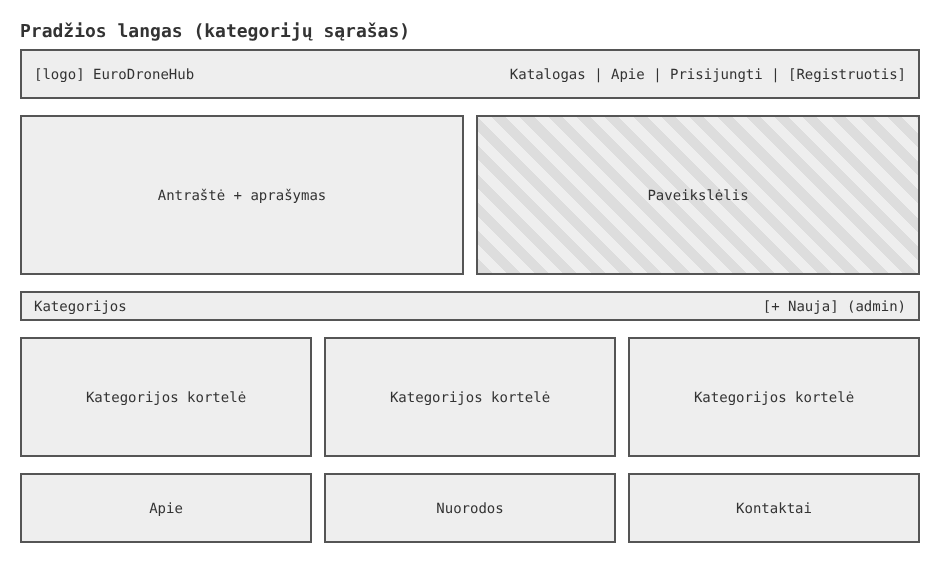 | 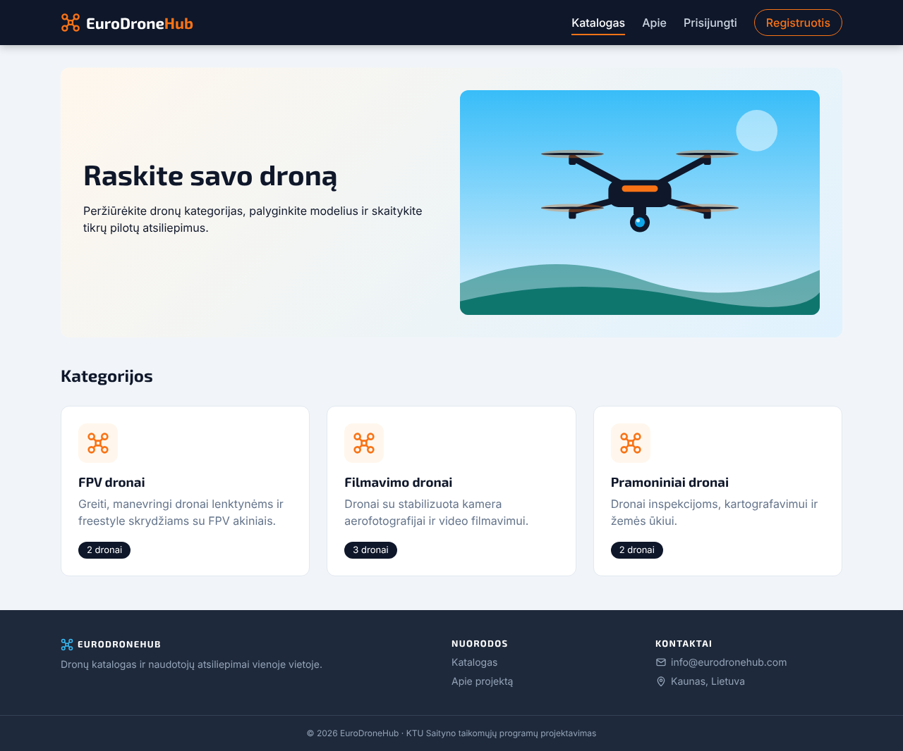 |
| 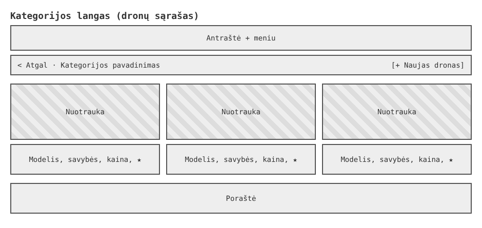 | 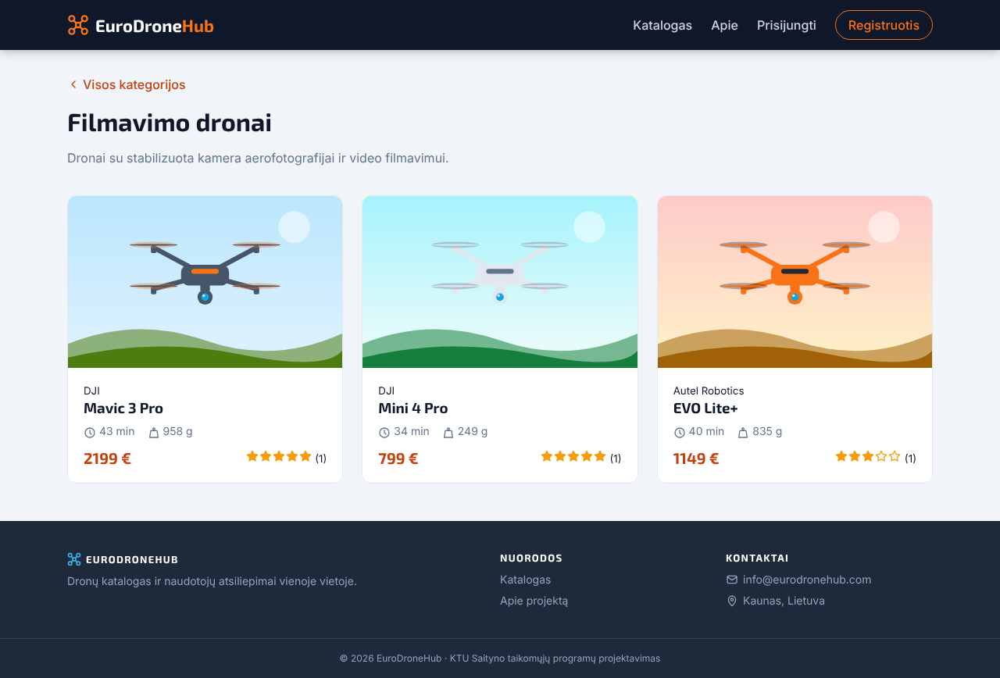 |
| 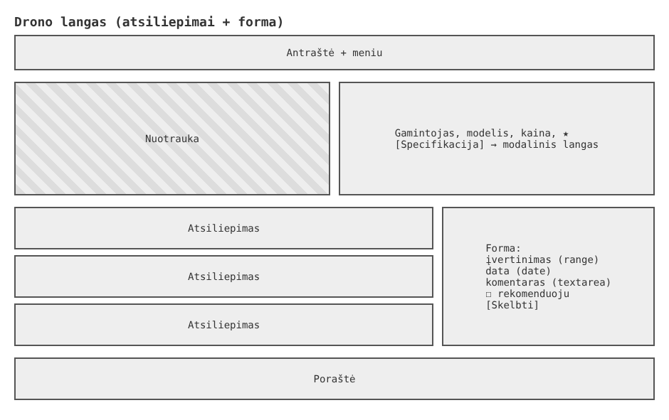 | 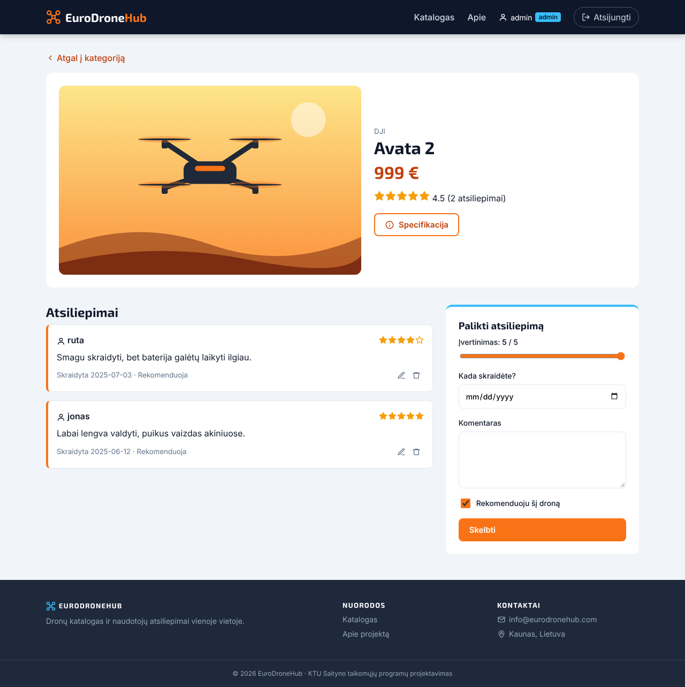 |
| 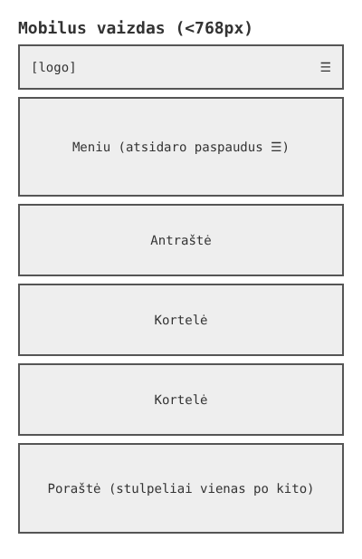 | 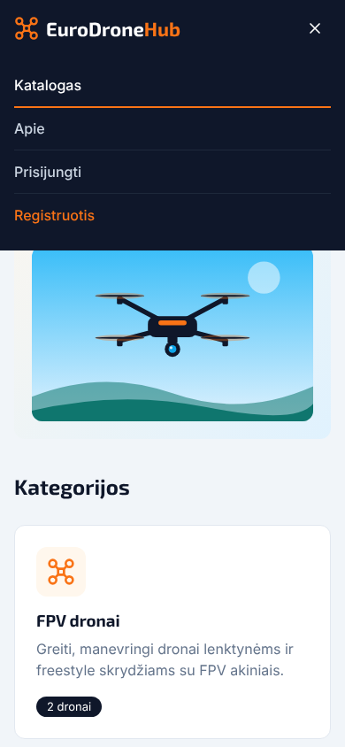 |

Kitos iškarpos:

| Modalinis langas (specifikacija) | Drono forma (admin) | Prisijungimas |
|---|---|---|
| 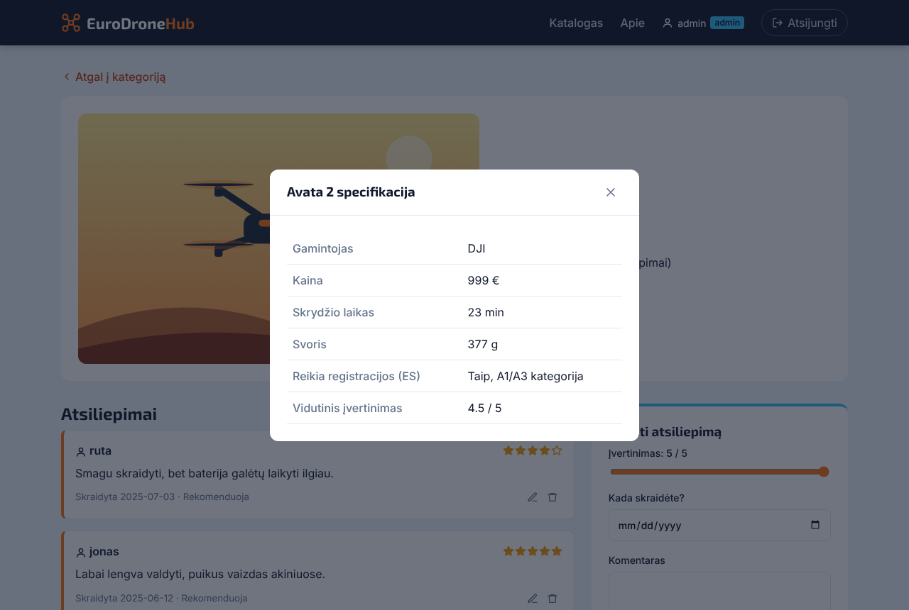 | 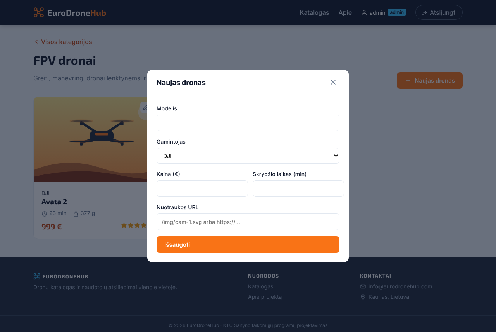 | 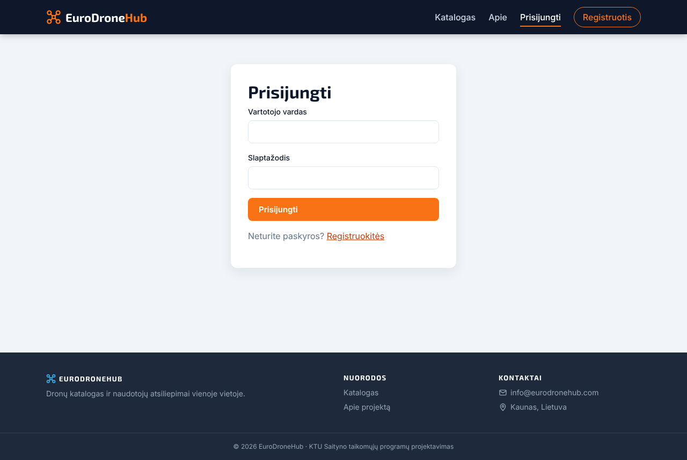 |

---

## 8. Testavimas

Postman kolekcija [`docs/EuroDroneHub.postman_collection.json`](docs/EuroDroneHub.postman_collection.json) patikrina visus 15 metodų bei klaidų atvejus (400, 401, 403, 404, 422), sukūrimą (201) ir ištrynimą (204). Kolekcija pati prisijungia, išsisaugo žetonus ir sukurtų objektų ID.

Paleidimas (serveris turi veikti):

```bash
npm run test:api
# arba kitam adresui:
npx newman run docs/EuroDroneHub.postman_collection.json --env-var baseUrl=https://<railway-adresas>
```

Rezultatas: 29 užklausos, 63 patikrinimai, 0 klaidų, ~0,6 s.

Postman programoje: *Import* → pasirinkti failą → *Run collection*.

---

## 9. Išvados

1. Suprojektuota ir realizuota REST principais veikianti API su trimis hierarchiškai susietais objektais (kategorija → dronas → atsiliepimas) ir 15 metodų, įskaitant hierarchinį dronų sąrašą pagal kategoriją.
2. Įgyvendinta JWT autentifikacija su refresh žetonų rotacija ir pakartotinio panaudojimo aptikimu; rolė saugoma žetono viduje, autorizacija tikrinama kiekviename apsaugotame metode (3 rolės).
3. API grąžina prasmingus atsako kodus (200, 201, 204, 400, 401, 403, 404, 409, 422), aprašyta OpenAPI specifikacija ir patikrinta automatiniais Postman testais.
4. Sukurta prisitaikanti React naudotojo sąsaja su hamburger meniu, modaliniais langais, animacijomis ir įvairiais formų elementais.
5. Sistema supakuota į vieną Docker konteinerį ir išdiegta Railway debesų platformoje. SQLite pasirinkimas supaprastino paleidimą ir diegimą, tačiau didesnei apkrovai tikslinga būtų pereiti prie PostgreSQL.
